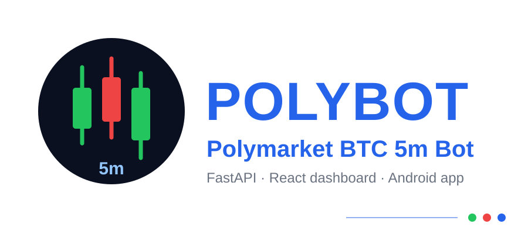

<p align="center">
  
</p>

<p align="center">
  <a href="https://github.com/mainnetwallet/Polybot-BTC-5m/releases/latest"></a>
  <a href="https://github.com/mainnetwallet/Polybot-BTC-5m/actions/workflows/android-apk.yml"></a>
  
</p>

<p align="center">
  
  
  
  
  
</p>

<p align="center">
  <a href="#quick-start-powershell">Quick start</a> ·
  <a href="android/README.md">Android app</a> ·
  <a href="#android-app-and-remote-access">Remote access</a> ·
  <a href="#vps-linux-server-247">VPS (Linux)</a> ·
  <a href="#how-it-works">How it works</a>
</p>

<p align="center">
  
</p>

Local Windows app (or Linux VPS, see [VPS](#vps-linux-server-247)) for Polymarket BTC up/down 5-minute markets: Python (FastAPI) backend, React dashboard and a native Android app (`android/`). **Paper trading is the default**; live trading is disabled until you pass explicit safety gates.

## Requirements

Windows 10/11, Python 3.11+, Node.js 20.19+ or 22.12+, Git, a synced system clock (clock drift makes books look stale), internet access to Polymarket.

## Quick start (PowerShell)

```powershell
git clone https://github.com/mainnetwallet/Polybot-BTC-5m.git
cd Polybot-BTC-5m
.\setup.bat      # once: venv, packages, .env from .env.example, data\ and logs\
.\start.bat      # start API + dashboard, opens the browser
.\stop.bat       # stop everything
```

Update and set up:

```powershell
cd .\Polybot-BTC-5m
git pull
.\setup.bat
```

Update and start:

```powershell
cd .\Polybot-BTC-5m
git pull
.\start.bat
```

Create `.env` (only if setup did not create it) and edit it:

```powershell
Copy-Item .env.example .env
notepad .env
```

- Dashboard `http://127.0.0.1:5173`, API `http://127.0.0.1:8000`, docs `/docs`.
- `start.bat` runs setup itself if `.venv`, `frontend\node_modules` or `.env` is missing, and **restarts** a running copy (`-NoRestart` keeps it, `-NoBrowser` skips the browser, `-Detach` returns the prompt).
- The bot always starts **STOPPED**; start it from the dashboard. Orders, positions and settings persist in `data\polymarket_bot.db`.
- `stop.bat` stops the bot through the API using `API_TOKEN` (or the admin login) from `.env`, then ends the processes.
- Update: `.\stop.bat`, `git pull`, `.\setup.bat`, `.\start.bat`.
- Clean reinstall: `.\stop.bat; Remove-Item -Recurse -Force .venv, frontend\node_modules; .\setup.bat` (keeps `.env` and the database).
- Private repo: sign in via Git Credential Manager; never put a token in the clone URL.

## Strategy

All values are defaults and can be changed in Settings or `.env`. Up to 3 buys per market; every stage buys and sells only its own shares.

| Stage | Entry | Take-profit | Stop-loss |
| --- | --- | --- | --- |
| **0** early buy | `160`-`100`s left, ask `0.70`-`0.96` (cheaper buys up to `0.85`; `0.89`+ only after 50% of the window), BTC gap >= `$70` beyond the price to beat (`$60` for the `0.89`+ buys). One buy per market | Best bid `+10%` / `+7%` / `+5%` over avg cost (buy below `0.80` / `0.80`-`0.85` / `0.85`+), at most bid `0.98` (`STAGE0_SELL_CAP_PRICE`, editable in Settings); `0` = hold | `70%` below avg cost (`20%` if bought at `0.89`+) |
| **1** stage 1 | `90`-`50`s left (until stage 2 starts), best ask >= `0.85`, gap >= `$35` (waits and buys as soon as it gets there inside that window) | Bought up to `0.88`: `+8%`; dearer: bid `0.98` | `18%` |
| **2** add-on | `<= 50`s left, ask `0.88`-`0.97`, spread <= `0.05`, gap >= `$30` | Bid `0.98` | `10%` |
| **3** add-on | `<= 30`s left, ask `0.90`-`0.98`, spread <= `0.05`, bid above the current stop by `0.01`, gap >= `$25` | held to settlement | `5%` |

- Orders are marketable BUY (FOK) at the current ask. `0.85` / `0.88` / `0.90` are triggers, never limit prices; `MAX_EXECUTION_PRICE` caps the price paid.
- Take-profit sells are marketable and never below their sell price. Stop-loss sells at market with no floor. `0` turns a stop-loss off.
- A blocked or failed entry is retried on the next book event and every 0.5s while the book is quiet.
- A partly filled paper buy is topped up only while its entry rules still hold (own time window, ask threshold, BTC gap, no kill switch / daily limit). Live FOK orders fill completely or not at all.
- A failed take-profit sell is retried every 50ms for ~450 attempts, then left to settlement. A failed stop-loss sell is never given up: after 450 fast attempts it keeps retrying once per second.
- Execution is WebSocket/event-driven, no sleeps in the trigger path.

## Dashboard

**Overview** market, countdown, UP/DOWN asks, feed health · **Strategy** live evaluation and trigger audit trail · **Trading** orders, positions, quick sell · **Analytics** PnL, win rate, fees · **Settings** runtime values, live readiness, resets · **Logs** live log stream.

## Configuration

`.env` is created by setup, read only at startup (restart after editing), git-ignored and must never be shared. Write `KEY=value` without quotes or spaces. **Every key is documented in [`.env.example`](.env.example).** Paper mode needs no edits.

Most used keys:

| Key | Default | Meaning |
| --- | --- | --- |
| `STAGE1_THRESHOLD` / `STAGE1_SECONDS` | `0.85` / `90` | Stage 1 ask trigger and window |
| `STAGE0..3_ENABLED` | `true` | Switch a stage fully on/off |
| `STAGE0_*`, `STAGE1_*`, `STAGE2_*`, `STAGE3_*` | see table above | Timing, ask range, take-profit, stop-loss per stage |
| `MIN_PRICE_GAP_USD` / `STAGE2_...` / `STAGE3_...` | `35` / `30` / `25` | BTC (Chainlink TWAP60) must be this far beyond the price to beat; `0` = off; missing BTC data blocks the buy |
| `TRADE_AMOUNT_USDC` | `50` | Notional per trade |
| `MAX_EXECUTION_PRICE` | `0.98` | Hard price cap for every stage, stage 0 included (stage 0 also needs `STAGE0_MIN_ASK` at or below it) |
| `STAGE1_MAX_ASK` | `0.97` | Stage 1 does not buy when the best ask is above this |
| `STAGE2_MAX_ASK` | `0.97` | Stage 2 does not buy when the best ask is above this (buys at 0.97, never at 0.98+); `STAGE2_SELL_PRICE` must be >= this + 0.01 |
| `STAGE2_MAX_SPREAD` | `0.05` | Stage 2 does not buy when best ask - best bid is wider than this (`0` = off) |
| `STAGE3_MAX_ASK` | `0.98` | Stage 3 does not buy when the best ask is above this (buys up to and including 0.98) |
| `STAGE3_MAX_SPREAD` | `0.05` | Stage 3 does not buy when best ask - best bid is wider than this (`0` = off) |
| `STAGE3_MIN_STOP_HEADROOM` | `0.01` | Stage 3 buys only if the best bid is at least this far above the stop-loss level that applies right now (`0` = off) |
| `STAGE0_BLOCK_ASK` | `0.98` | Same for stage 0 (stage 0 keeps 0.98) |
| `STAGE1..3_BLOCK_ASK` | `0.99` | Once either side's best ask reaches this inside that stage's window, the stage stops buying in that market (even if the ask falls back). Per market and per stage; resets on restart |
| `STALE_DATA_MAX_AGE_MS` | `2000` | Max book age for a buy (exits skip the check) |
| `MAX_DAILY_LOSS` / `DAILY_PROFIT_TARGET` / `MAX_TRADES_PER_DAY` | `5.0` / `10.0` / `600` | Risk limits |
| `MAX_OPEN_POSITIONS` | `1` | Per-market position cap |
| `DUPLICATE_POLICY` | `one_per_market` | or `one_per_side`, `allow` |
| `CONFLICT_POLICY` | `up_first` | or `down_first`, `highest_ask`, `block_both` |
| `PAPER_STARTING_BALANCE` / `PAPER_FILL_RATIO` / `PAPER_SLIPPAGE_BPS` / `PAPER_FEE_RATE` | `100.0` / `1.0` / `0` / `0.07` | Paper simulation |
| `API_TOKEN`, `ADMIN_USERNAME`, `ADMIN_PASSWORD` | empty / `admin` / empty | API secret and dashboard login (empty password = login disabled) |

Settings page overrides (stored in SQLite): trigger, stage 1, max price, trade amount, daily loss/target, stale age, duplicate/conflict policy, paper slippage/fee, trades per day, open positions. Secrets and live switches are environment-only.

## Live trading

Off by default, never enabled automatically. All of these are required:

1. `LIVE_TRADING_ENABLED=true` and `POLYMARKET_GEO_VERIFIED=true` (only after confirming your jurisdiction is eligible)
2. `POLYMARKET_PRIVATE_KEY` and `POLYMARKET_FUNDER_ADDRESS` with funded **pUSD** (API-only wallets must wrap USDC.e via the Collateral Onramp) and a positive CLOB allowance
3. Bot stopped with no outstanding orders, mode switched in the dashboard, confirmation phrase `GO LIVE`

`POLYMARKET_SIGNATURE_TYPE`: `0` EOA, `1` email/Magic proxy, `2` browser (MetaMask) proxy, `3` smart-contract wallet. For types 1-3 the funder is the **proxy wallet address from your Polymarket profile**, not your MetaMask address. Unsure which type? Run `.venv\Scripts\python.exe scripts\check_wallet.py` (read-only, shows the pUSD balance per type).

Winning tokens become pUSD only after redemption: claim on polymarket.com, or set `LIVE_AUTO_REDEEM=true` and `pip install -r backend/requirements-redeem.txt` (optional Relayer key for gasless redeem). Keys are read from the environment only and never sent to the browser. The kill switch blocks new orders and stops the bot; it cannot undo fills.

**Stopping the bot does not protect open positions.** While the bot is stopped (or the kill switch is on) take-profit and stop-loss do not run and manual *Sell* is refused. Before you press Stop, sell or accept the open live positions; they otherwise settle at market end.

Paper mode uses live market data, simulates fills against the ask ladder and keeps its balance and stats separate from live. Settlement: a position shows *settling...* until the winner is known (CLOB, Gamma, wallet `redeemable`); a WARNING in Logs appears after 3 minutes.

## Android app and remote access

`android/` is a native Kotlin/Compose client for the same REST API and WebSocket (no trading logic of its own). Build, install and APK releases: [android/README.md](android/README.md).

Away from home the PC publishes a free Cloudflare quick tunnel and writes its changing URL into a secret GitHub Gist that the app reads:

1. In `.env` set a long random `API_TOKEN` (32+ chars), keep `HOST=127.0.0.1`, change `ADMIN_PASSWORD`.
2. Create a classic GitHub token with **only** the `gist` scope and set `GIST_TOKEN=...`.
3. Add `QUICK_TUNNEL=1`, run `start.bat` (installs `cloudflared` via winget if missing, prints `In the app enter: gist:<id>`).
4. In the app enter `gist:<id>` and the `API_TOKEN`, tap *Test connection*, then *Save*. After a PC restart the app re-reads the Gist and reconnects itself.

Every endpoint except `/healthz` and `/api/health` needs `API_TOKEN`; treat it and `GIST_TOKEN` like passwords.

## VPS (Linux server, 24/7)

Runs the same backend on a Linux VPS. The FastAPI process serves the dashboard itself (from `backend/app/static`), so there is **no Vite dev server** on a VPS; Node.js is only used to build the dashboard. `setup.bat` / `start.bat` / `stop.bat` are Windows-only: on a VPS `systemd` starts, restarts and stops the bot, and Cloudflare quick tunnel + Gist (`QUICK_TUNNEL`, `GIST_TOKEN`) are not needed because the VPS has a fixed address.

**You need:** a VPS with Ubuntu 24.04 (Python 3.12) or Debian 12 (Python 3.11), 1 vCPU / 1 GB RAM or more, root SSH access, and a region where Polymarket is reachable and allowed for you (step 5 checks the feed). A domain name is optional (step 8). Ubuntu 22.04 ships Python 3.10, which is too old: install 3.11+ first (`add-apt-repository ppa:deadsnakes/ppa`, `apt install python3.12 python3.12-venv`) and use `python3.12` in step 4.

Steps 1, 6, 7, 8 and 9 run as `root`; steps 3-5 run as the `polybot` user.

### 1. System packages (root)

```bash
apt update && apt upgrade -y
apt install -y git curl ca-certificates build-essential python3 python3-dev python3-venv python3-pip chrony sqlite3 ufw
curl -fsSL https://deb.nodesource.com/setup_22.x | bash -
apt install -y nodejs
systemctl enable --now chrony      # synced clock is required, clock drift makes books look stale
python3 --version                  # must be 3.11 or newer
node --version                     # must be 20.19+ or 22.12+
chronyc tracking | head -3
```

### 2. Dedicated user (root)

The bot never needs root. It runs as its own user:

```bash
adduser --disabled-password --gecos "" polybot
su - polybot
```

### 3. Get the code (as `polybot`)

Public repo:

```bash
git clone https://github.com/mainnetwallet/polybot-btc-5m.git
```

Private repo: use a read-only deploy key (never put a token in the clone URL):

```bash
ssh-keygen -t ed25519 -N "" -C polybot-vps -f ~/.ssh/id_ed25519
cat ~/.ssh/id_ed25519.pub          # GitHub repo > Settings > Deploy keys > Add deploy key (read-only)
ssh-keyscan github.com >> ~/.ssh/known_hosts
git clone git@github.com:mainnetwallet/polybot-btc-5m.git
```

### 4. Install and configure (as `polybot`)

```bash
cd ~/polybot-btc-5m

# Python environment
python3 -m venv .venv
.venv/bin/pip install --upgrade pip
.venv/bin/pip install -r backend/requirements.txt
# only for LIVE_AUTO_REDEEM=true:  .venv/bin/pip install -r backend/requirements-redeem.txt

# Dashboard: build it and put it where the backend serves it from
(cd frontend && npm ci --no-fund --no-audit && npm run build)
rm -rf backend/app/static/* && cp -r frontend/dist/. backend/app/static/

# Configuration
cp .env.example .env
sed -i "s|^API_TOKEN=.*|API_TOKEN=$(openssl rand -hex 32)|" .env
sed -i "s|^ADMIN_PASSWORD=.*|ADMIN_PASSWORD=$(openssl rand -base64 18 | tr -d '/+=')|" .env
sed -i 's|^LIVE_TRADING_ENABLED=.*|LIVE_TRADING_ENABLED=false|' .env
sed -i 's|^QUICK_TUNNEL=.*|QUICK_TUNNEL=0|' .env
chmod 600 .env
grep -E '^(API_TOKEN|ADMIN_USERNAME|ADMIN_PASSWORD)=' .env     # write these down: dashboard login + app token

# Database
(cd backend && ../.venv/bin/python -c "from app.database.migrate import ensure_schema; ensure_schema(); print('database ready')")
```

- `.env.example` ships with `LIVE_TRADING_ENABLED=true` and `POLYMARKET_GEO_VERIFIED=true`; the `sed` lines above switch live trading off for the first run. Go live later only through [Live trading](#live-trading).
- Keep `HOST=127.0.0.1` and `PORT=8000` in `.env`. The address the server really binds to is the `--host/--port` in the systemd unit (step 6); `.env` `HOST`/`PORT` only drive the app's safety warnings, so keep them identical.
- Edit anything else with `nano .env` (every key is documented in `.env.example`). `.env` is read only at startup.

### 5. Check that the VPS can reach Polymarket (as `polybot`)

```bash
.venv/bin/python scripts/check_btc_feed.py
```

It prints what Polymarket answers for the price to beat and the BTC feed. If it is refused or empty, the region or IP of the VPS is blocked: choose another region or provider before going further. Then leave the `polybot` user:

```bash
exit
```

### 6. systemd service (root)

```bash
cat > /etc/systemd/system/polybot.service <<'EOF'
[Unit]
Description=Polybot BTC 5m (FastAPI)
After=network-online.target chrony.service
Wants=network-online.target

[Service]
Type=simple
User=polybot
Group=polybot
WorkingDirectory=/home/polybot/polybot-btc-5m/backend
ExecStart=/home/polybot/polybot-btc-5m/.venv/bin/python -m uvicorn app.main:app --host 127.0.0.1 --port 8000 --no-access-log
Restart=always
RestartSec=3
LimitNOFILE=65536
NoNewPrivileges=true
PrivateTmp=true

[Install]
WantedBy=multi-user.target
EOF

systemctl daemon-reload
systemctl enable --now polybot
sleep 3
systemctl status polybot --no-pager
curl -s http://127.0.0.1:8000/healthz      # {"status":"ok"}
```

Run exactly **one** uvicorn process (no `--workers`): the bot keeps its state in memory. After a crash, `systemctl restart` or a reboot the bot comes back **STOPPED** (by design), so open the dashboard and press Start again. While it is stopped, take-profit and stop-loss do not run (see [Live trading](#live-trading)).

### 7. Open the dashboard

Pick one.

**A. SSH tunnel (no domain, nothing exposed, simplest).** On your PC (or in Termux on your phone):

```bash
ssh -L 8000:127.0.0.1:8000 root@YOUR_VPS_IP
```

Keep it open and browse to `http://127.0.0.1:8000`; log in with `ADMIN_USERNAME` / `ADMIN_PASSWORD`.

**B. Your own domain with HTTPS (step 8).** Needed if the Android app should reach the bot from anywhere.

### 8. HTTPS with nginx + Let's Encrypt (root, optional)

Point a DNS `A` record (for example `bot.example.com`) at the VPS IP first, then:

```bash
apt install -y nginx certbot python3-certbot-nginx

cat > /etc/nginx/sites-available/polybot <<'EOF'
map $http_upgrade $connection_upgrade {
    default upgrade;
    ''      close;
}

server {
    listen 80;
    server_name bot.example.com;

    location / {
        proxy_pass http://127.0.0.1:8000;
        proxy_http_version 1.1;
        proxy_set_header Host $host;
        proxy_set_header X-Real-IP $remote_addr;
        proxy_set_header X-Forwarded-For $proxy_add_x_forwarded_for;
        proxy_set_header X-Forwarded-Proto $scheme;
        proxy_set_header Upgrade $http_upgrade;
        proxy_set_header Connection $connection_upgrade;
        proxy_read_timeout 3600s;
        proxy_send_timeout 3600s;
    }
}
EOF

sed -i 's/bot.example.com/YOUR.DOMAIN/' /etc/nginx/sites-available/polybot     # put your real domain here
ln -sf /etc/nginx/sites-available/polybot /etc/nginx/sites-enabled/polybot
rm -f /etc/nginx/sites-enabled/default
nginx -t && systemctl reload nginx
certbot --nginx -d YOUR.DOMAIN --redirect -m you@example.com --agree-tos -n
```

Open `https://YOUR.DOMAIN`. The `Host`, `X-Forwarded-Proto` and `Upgrade` headers matter: without `Host` the server answers `403 Cross-site request blocked`, without `Upgrade` the live WebSocket does not connect.

**Android app:** enter `https://YOUR.DOMAIN` and the `API_TOKEN` from `.env`, tap *Test connection*, then *Save*. No Gist is needed on a VPS.

### 9. Firewall (root)

```bash
ufw allow OpenSSH            # assumes SSH on port 22; adjust if you changed it
ufw allow 'Nginx Full'       # only if you did step 8 (ports 80 and 443)
ufw --force enable
ufw status
```

Port 8000 stays closed to the internet because the bot only listens on `127.0.0.1`. Do not change `--host` to `0.0.0.0`: the login and the token would travel over plain HTTP.

### Daily use

```bash
systemctl status polybot --no-pager         # is it running
systemctl restart polybot                   # after editing .env (bot comes back STOPPED)
systemctl stop polybot                      # stop everything
journalctl -u polybot -f                    # live service log
tail -f /home/polybot/polybot-btc-5m/logs/backend.log
```

### Update to the latest version (root)

```bash
su - polybot -c 'cd polybot-btc-5m && git checkout -- backend/app/static && git clean -fdq backend/app/static && git pull && .venv/bin/pip install -r backend/requirements.txt && (cd frontend && npm ci --no-fund --no-audit && npm run build) && rm -rf backend/app/static/* && cp -r frontend/dist/. backend/app/static/'
systemctl restart polybot
```

The first two `git` commands drop the previously built dashboard so `git pull` never conflicts; the build and copy at the end recreate it. `.env`, `data/` and `logs/` are git-ignored and untouched.

### Backup (root)

The database holds orders, positions and settings. Use SQLite's own backup (a plain `cp` can miss recent writes):

```bash
mkdir -p /root/polybot-backups
sqlite3 /home/polybot/polybot-btc-5m/data/polymarket_bot.db ".backup '/root/polybot-backups/polymarket_bot-$(date +%F).db'"
cp /home/polybot/polybot-btc-5m/.env /root/polybot-backups/env-$(date +%F) && chmod 600 /root/polybot-backups/env-*
```

### VPS troubleshooting

- **Service does not start** - `journalctl -u polybot -n 50 --no-pager` and `tail -n 50 /home/polybot/polybot-btc-5m/logs/backend.log`. Port in use: `ss -ltnp | grep 8000`.
- **nginx `502 Bad Gateway`** - the service is not running (`systemctl status polybot`).
- **`403 Cross-site request blocked` on login or buttons** - nginx is not forwarding `Host` (see step 8), or you open the dashboard from an address that is neither the server itself nor listed in `CORS_ORIGINS`.
- **Dashboard shows an old or blank UI** - the build was not copied: repeat the dashboard build and `cp` in step 4, then `systemctl restart polybot`.
- **No BTC price / books look stale** - run `scripts/check_btc_feed.py` (step 5) and `chronyc tracking` (clock). Do not raise `STALE_DATA_MAX_AGE_MS`.
- **Locked out of the login** - 5 wrong passwords lock the IP for 30 s and longer; wait, or check `ADMIN_PASSWORD` in `.env`.
- **Live wallet check** - `.venv/bin/python scripts/check_wallet.py` (as `polybot`, read-only).

## How it works

```text
Gamma API (market discovery) -> active BTC up/down market
  -> CLOB WebSocket (book, price_change, best_bid_ask)
  -> strategy engine -> execution guards (fresh data, price cap, risk, duplicate/conflict, expiry)
  -> paper engine (simulated) or live engine (CLOB FOK)
  -> SQLite + analytics -> WebSocket push (every book event) -> dashboard / Android app
```

Orders are never sent after market expiry; duplicates are blocked by per-market locks and an idempotency key. Backend modules (`backend/`): `market_discovery`, `market_data`, `strategy`, `risk_manager`, `order_manager`, `paper_trading`, `live_trading`, `portfolio`, `monitoring`, `services.bot`, `api`.

## Data, logs and resets

- `data\polymarket_bot.db` (SQLite) · `logs\backend.log` (rotating) · `logs\*.out.log` / `*.err.log` (uvicorn, vite) · `logs\pids\`
- **Settings > Danger zone:** *Reset paper account* (bot stopped; live data untouched), *Reset daily trades & PnL* (any time, lifts daily halts), *Full server reset* (wipes the database, back to paper/`.env` defaults, type `RESET ALL`, refused while live positions are open).

## Testing

```bat
cd backend && ..\.venv\Scripts\python.exe -m pytest -q
cd frontend && npm run build
```

## Limitations

- Live execution was never exercised with real funds; `POLYMARKET_GEO_VERIFIED` is `true` in `.env.example` (set it to `false` if you are not sure Polymarket is allowed where you live); the code default is `false`.
- Paper fees are approximate; on-chain reconciliation is best-effort (CLOB responses only).
- Gamma can keep a market `closed:false` for a while after expiry, so a paper position may stay open across a restart.
- Only one market family (`SERIES_SLUG`, default `btc-up-or-down-5m`).
- Fix clock sync instead of raising `STALE_DATA_MAX_AGE_MS`.

## Troubleshooting

- **`.\setup.bat` not recognized** - PowerShell needs the `.\` prefix. **`python`/`node`/`git` not found** - install, reopen PowerShell, rerun setup.
- **`.env` change ignored** - restart (`.\stop.bat`, `.\start.bat`). **Bot STOPPED after restart** - intended.
- **Port 8000/5173 in use** - close the other process or run `.\stop.bat`. **Startup failed** - read `logs\backend.err.log`, `logs\frontend.err.log`, `logs\backend.log`.
- **Bot does not trade** - check it is RUNNING, the market is in a stage window, the ask reaches the trigger, data is fresh, risk limits are intact, and the Strategy audit trail for blocks.
- **Paper reset does nothing** - stop the bot first. **Live options disabled** - intended, see Live trading.

## Risk warning

This software can place real orders if you enable live trading. Prediction markets are risky and you can lose your entire balance. Start in paper mode, verify your jurisdiction and credentials, use small sizes. Not financial advice.
